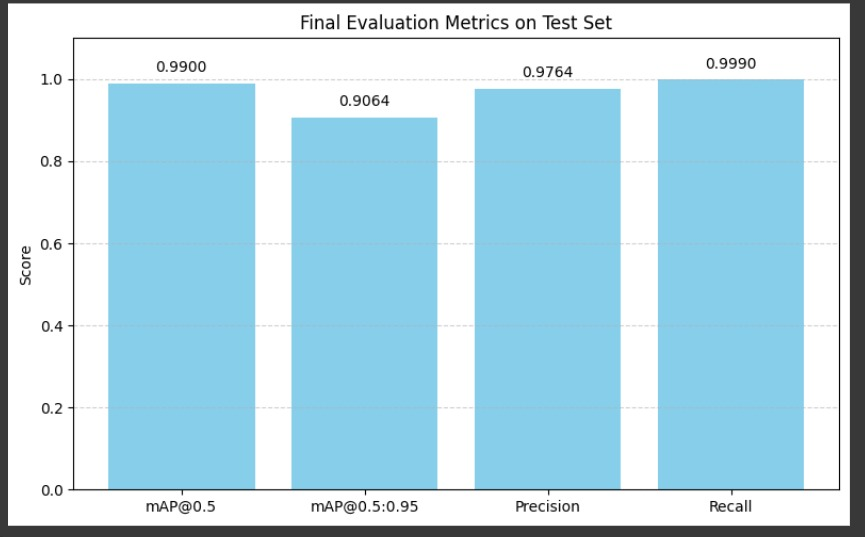

# Smart Grocery System

A desktop prototype that recognizes grocery and personal-care products through a webcam, displays detections, and suggests related products. It combines an **Ultralytics YOLO detector**, **OpenCV video capture**, and a **Tkinter interface**.

The repository includes trained weights for inference and a separate notebook for dataset exploration, training, and evaluation.

## What you can do

- Start and stop a live webcam preview with annotated detections.
- Add currently detected product names to a cart and clear the cart.
- See suggestions from a fixed dictionary of related products.
- Explore YOLO annotations, class distributions, image sizes, and model validation in the training notebook.

The cart stores unique names in memory; it does not track quantities or prices. Recommendations are rule-based and depend on the current frame's detections, rather than learned customer preferences or cart history.

## How the application works

```text
Webcam frame → YOLO prediction (confidence ≥ 0.3) → annotated preview
                         ↓
                   detected names → fixed recommendation mapping
                         ↓
                   Add to Cart → unique product names
```

`get_recommendations` looks up the detected names in `recommendation_buckets`, combines the suggestions, and removes products already detected in the same frame. For example, the mapping for **Lays Masala** includes Kolson Slanty Jalapeno, Kurkure Chutney Chaska, and Lays Wavy Mexican Chili.

## Quick start: webcam application

You need a local desktop with Python, a working webcam, and Tkinter. This GUI requires a display and is not designed to run directly in a headless Colab session.

```bash
git clone https://github.com/gautambalgi/SmartGrocerySystem.git
cd SmartGrocerySystem
python -m venv .venv
```

Activate the environment:

```powershell
# Windows PowerShell
.venv\Scripts\Activate.ps1
```

```bash
# macOS / Linux
source .venv/bin/activate
```

Install the application's dependencies:

```bash
python -m pip install ultralytics opencv-python pillow
python -m tkinter
```

The last command should open a small Tkinter test window. On systems where Tkinter is not installed with Python, install the corresponding system package.

### Fix the model path before launching

The final line that constructs `YOLOCameraApp` in `FinalApp/app.py` contains an absolute path from the original development environment. Replace that construction with:

```python
app = YOLOCameraApp(root, model_path="best.pt")
```

Then run from the directory containing the bundled weights:

```bash
cd FinalApp
python app.py
```

Alternatively, set `model_path` to the full path of your local `FinalApp/best.pt`. The checked-in application still contains the original absolute path; this adjustment is required for a new installation.

### Use the interface

1. Click **Start** to open camera index `0` and begin detection.
2. Hold a supported product in view. Boxes and labels appear over the image, with related-product suggestions below.
3. Click **Add to Cart** to add the latest detected names. Repeated detections do not add duplicate names.
4. Click **Clear Cart** to reset the list, or **Stop** to release the webcam.

## Dataset and training

Open [the preprocessing and modelling notebook](Preprocessing%26modelling/preprocessing%26modelling.ipynb) for the training workflow. The original dataset is linked in the repository's training documentation: [download dataset](https://drive.google.com/file/d/1HfQR301KV02c1FTm3zIAtiodv0-DgLak/view?usp=sharing). Access depends on that external file's sharing settings; the dataset is not committed here.

The notebook's explicit class list contains **25 product classes**, covering snacks, biscuits, drinks, tea, and personal-care products. Examples include Lays Masala, Coca Cola Can, Safeguard Bar Soap Pure White, and Vaseline Healthy White Lotion. This is a specific product detector rather than recognition of arbitrary supermarket items.

The notebook:

1. Extracts a YOLO-format archive and reads `data.yaml`.
2. Counts images and annotations, compares class distributions, and visualizes bounding boxes.
3. Inspects box-center heatmaps, image resolutions, and dataset splits.
4. Loads `yolov8n.pt` and calls training with **25 epochs**, **640-pixel images**, and **batch size 16**.
5. Loads a resulting `best.pt`, calls validation, and runs image predictions.

Update the archive, dataset, sample-image, and run-directory paths before executing. The notebook uses several inconsistent `/content/...` directory names. Its executable training cell specifies 25 epochs, even though an earlier narrative section describes a two-epoch run.

## Reading the evaluation

The notebook includes validation calls and a chart with manually entered scores: mAP@0.5 `0.9900`, mAP@0.5:0.95 `0.9064`, precision `0.9764`, and recall `0.9990`. These are recorded project values, not independently reproduced results.

Although a later heading says “Test Set,” the code reuses metrics from `model.val()` without explicitly selecting `split="test"`. Treat the chart as a saved project illustration until the dataset, split, and weights are verified in a fresh evaluation. mAP is an average-precision metric, not the percentage of all predictions that are correct.



## Repository guide

| Path | Contents |
|---|---|
| [`FinalApp/`](FinalApp/) | GUI application, bundled `best.pt`, and application instructions |
| [`Preprocessing&modelling/`](Preprocessing%26modelling/) | Training notebook and dataset instructions |
| `evaluation_metrics.jpg` | Recorded evaluation chart |
| `lays_masala.jpg`, `safeguard_soap.jpg`, `vaseline_white.jpg` | Example product images |

## Troubleshooting and current limits

- **Weights not found:** correct `model_path` and launch from `FinalApp` when using `"best.pt"`.
- **No camera image:** check camera permissions, close other camera applications, or change `cv2.VideoCapture(0)` to your camera's index.
- **No recommendations:** the detected class name must exactly match a key in `recommendation_buckets`.
- **GUI instability:** the prototype updates Tkinter widgets from a background thread and has limited shutdown/error handling. This may require changes for reliable long-running use.
- **Recognition errors:** lighting, viewpoint, packaging changes, and unsupported products affect predictions. The app has no checkout, persistent inventory, billing, or database integration.

Dependencies are not pinned and no automated test suite is included. The instructions above describe the code and required setup adjustments; they do not imply a fresh webcam or training benchmark.
